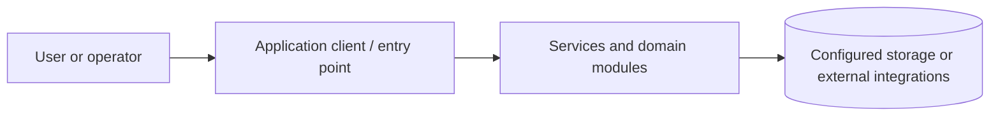
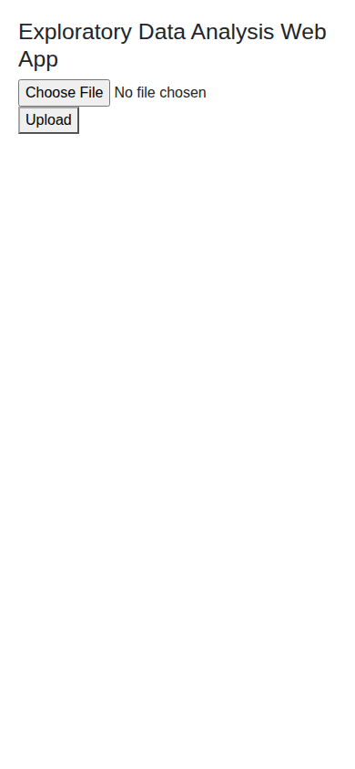

# Python Data Science & EDA Portfolio | Flask, Pandas, React

Python experiments, notebooks and an exploratory data analysis web application built with Flask, pandas, NumPy, scikit-learn and React/Vite.

**Explore this repository:** [Architecture](docs/ARCHITECTURE.md) · [Developer runbook](docs/RUNBOOK.md) · [Screenshot evidence guide](docs/SCREENSHOT_GUIDE.md) · [Audit](docs/PORTFOLIO_AUDIT.md)

**Discoverability topics:** `python` · `data-science` · `exploratory-data-analysis` · `flask` · `pandas` · `numpy` · `machine-learning` · `react`. These are suggested GitHub repository topics, not a claim that the repository settings have been updated.

> **Status:** Source-reviewed documentation draft. Runtime startup, end-to-end tests and screenshots have **not** been independently verified. Review PR before merging.

A learning and experimentation repository containing Python notebooks, computer vision work, and a Flask/React exploratory data analysis application.

## Repository map

- `eda-webapp/backend/` — Flask analysis API.
- `eda-webapp/frontend/` — React/Vite interface.
- `Assignment1/`, `Colab Notebooks/`, `python/` — notebooks and exercises.
- `Face recognization/` — OpenCV experiments.

## Technology

Python, Flask, pandas, NumPy, scikit-learn, React, Vite.

## Getting started

### Prerequisites

Install the runtime and tools relevant to this project (Node.js/npm, Python, .NET SDK, mobile SDK, or desktop runtime). Use the package manifest and lockfile to determine exact compatible versions. Obtain required databases and API credentials from your own provider accounts; never commit secrets.

### Install and run

**EDA backend:** `cd eda-webapp/backend`; create a Python virtual environment, `pip install -r requirements.txt`, then `python app.py`.

**EDA frontend:** `cd eda-webapp/frontend && npm ci && npm run dev`. Confirm the API base URL in `src/api.js`.

> These commands are derived from repository manifests, not confirmed by an end-to-end launch. If startup fails, inspect the relevant service's environment variables, dependency versions and logs.

## Architecture and data flow

This is a **conceptual overview**, not a verified deployment topology. The directory map above identifies the actual code areas to inspect for detailed component boundaries.

## Validation and troubleshooting

1. Confirm compatible runtime versions and install dependencies using the checked-in lockfiles.
2. Supply local environment variables through ignored files or a secrets manager.
3. Start required database, queue, mobile emulator or API dependencies.
4. Run scripts declared in the package manifests; record exit codes and failing commands.
5. Verify a complete user workflow with **non-sensitive demo data**.
6. Capture screenshots only after successfully launching the real application.

If you see a connection error, verify service endpoints and credentials without printing secrets. If a native build fails, verify platform SDK versions and native dependencies. Never treat a successful dependency installation as proof that the app works.

## Screenshots

Automated Chromium screenshot capture has been configured in GitHub Actions. The images below appear **only after a successful build, browser launch, and screenshot commit**. They represent the frontend running in CI, not a verified end-to-end backend workflow.

## Security and maintenance notes

Notebooks are experiments and may require separate datasets, models, and environment versions.

Review dependency advisories, license terms, authorization boundaries, sensitive files and third-party integrations before public deployment.

## Contributing

Open an issue with a reproducible description. Work on a feature branch, keep changes focused, update tests and docs, and request review through a pull request. Do not include credentials, customer data or personal information in issues or screenshots.

## Documentation status

- [x] Purpose and source-derived architecture overview
- [x] Repository map and initial run instructions
- [x] Security and operational caveats
- [ ] Clean-environment startup verified
- [ ] End-to-end workflow tested
- [ ] Real screenshots captured and reviewed
- [ ] Production readiness assessed

For the detailed verification checklist see [docs/PORTFOLIO_AUDIT.md](docs/PORTFOLIO_AUDIT.md).
