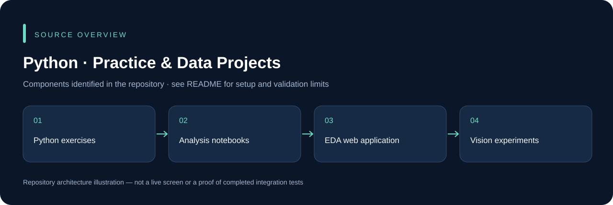

# Python · Practice & Data Projects

Python practice work from the CM Internship Program, with notebooks, data cleaning, exploratory analysis, a small EDA web application and computer-vision experiments. Different folders are independent exercises; there is no single root application.

## Explore the projects

| Location | Contents |
| --- | --- |
| `Assignment1/` | Notebook exercises and a small chatbot/web exercise |
| `eda-webapp/backend/` | Python EDA service |
| `eda-webapp/frontend/` | React/Vite EDA frontend |
| `python/` | Data-cleaning, analysis and practice scripts |
| `Face recognization/` | OpenCV experiment |

## Python environment

```powershell
python -m venv .venv
.\.venv\Scripts\Activate.ps1
python -m pip install --upgrade pip
```

Install the `requirements.txt` for the specific exercise, not every dependency from unrelated folders. For example, `python -m pip install -r eda-webapp/backend/requirements.txt`. Read the selected script's input-file expectations before running it. Start the EDA frontend with `npm ci` and `npm run dev` inside `eda-webapp/frontend`.

Notebook outputs, datasets and model availability differ by exercise. No face-recognition accuracy or complete analysis pipeline is certified by this documentation review. **Author: Asim Ali.**

## Source overview



This diagram is derived from the repository structure; it is not an application screenshot.

## Development and validation

Use an isolated development database and synthetic records. Keep credentials, device sessions, signing keys and operational uploads outside Git. The presence of source code does not establish that every integration or deployment scenario has been tested. See [repository review](docs/REPOSITORY_REVIEW.md) for this audit's scope.

## Ownership and contributions

Existing author, template, asset and dependency attributions remain in place. Follow any existing license files; this documentation update does not grant a new license. For a change, describe the affected workflow, configuration and checks so it can be reviewed without guessing.
